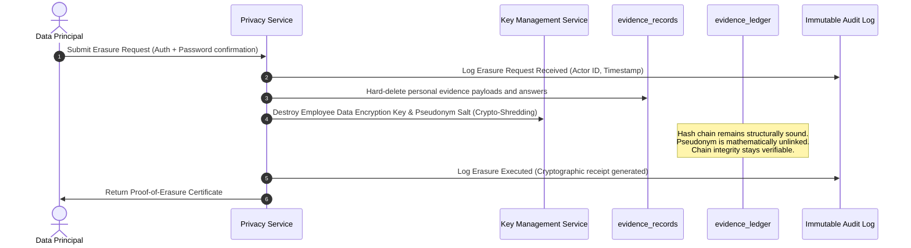

# TRELLIS Privacy, Data Classification & Consent Catalogue

## 1. Statutory Alignment: India DPDP Act
TRELLIS is engineered to adhere to the Digital Personal Data Protection Act (DPDP Act) and its notified implementation rules:
- **Data Fiduciary**: CSM Technology.
- **Data Principals**: Employees, contractors, and prospective candidates taking Growth Checks.
- **Data Protection Officer (DPO)**: Contact designated at `dpo@csmtech.example.com`.

---

## 2. Enterprise Data Classification

| Classification Tier | Data Types & Fields | Encryption & Protection Standard | Access Boundary | Retention Baseline |
|---|---|---|---|---|
| **Tier 1: Public** | System health status, public credential verification keys, public knowledge wiki entries. | TLS 1.3 in transit. | Unrestricted public access. | Indefinite. |
| **Tier 2: Internal** | Course catalogs, pathway curriculum, anonymized skill taxonomy, non-confidential Greenhouse ideas. | TLS 1.3; database encryption at rest (AES-256). | Authenticated employees of CSM Technology. | Platform lifecycle. |
| **Tier 3: Confidential** | Cohort attendance, team-level aggregated skill gaps (`n >= 5`), draft pathways, department knowledge post-mortems. | TLS 1.3; database encryption at rest; tenant `org_id` row-filtering. | Role-bounded (Trainers, Managers, Admins). | 3 years post-cohort completion. |
| **Tier 4: Personal Identifiable (PII)** | Employee full name, email, employee code, department, assessment attempt timestamps, access receipts. | TLS 1.3; encrypted at rest; repository-level authorization filters; access receipts logged. | Employee self-view; authorized manager/trainer with consent. | Duration of employment + 180 days. |
| **Tier 5: Sensitive Personal Data (SPDI)** | Raw psychometric responses (IPIP Big Five), accommodations requests, detailed exam attempt answers. | Field-level encryption (AES-256-GCM) with per-employee envelope keys (DEK); keys managed in external KMS. | Employee self-view only. Never visible to trainers or managers. | Duration of employment; erasable on demand via crypto-shredding. |

---

## 3. Purpose Specification & Consent Catalogue

All personal data processing in TRELLIS is bounded by explicit purpose codes recorded in the `consents` table:

| Purpose Code | Purpose Title | Lawful Basis | Consent Type | Revocation Impact |
|---|---|---|---|---|
| `PURPOSE_ONBOARDING_LEARNING` | Employee Induction & Learning Pathways | Employment Contract / Legitimate Uses | Mandatory (Notice provided) | Not revocable during active employment (core operational requirement). |
| `PURPOSE_SKILL_ASSESSMENT` | Technical & Coding Competency Evaluations | Legitimate Uses (Skills Development) | Mandatory (Notice provided) | Affects ability to award verifiable certifications. |
| `PURPOSE_MANAGER_SUMMARY_SHARE` | Sharing Consented Growth Ring with Line Manager | Explicit Consent (DPDP Section 6) | **Opt-In** (Default: Off) | Line manager view reverts immediately to unidentifiable team aggregates. |
| `PURPOSE_OPPORTUNITIES_MATCH` | Talent Marketplace & Gig Recommendations | Explicit Consent (DPDP Section 6) | **Opt-In** (Default: Off) | Profile is immediately unlisted from internal project matching. |
| `PURPOSE_PSYCHOMETRICS` | Voluntary Developmental Reflection & Work Values | Explicit Consent (DPDP Section 6) | **Opt-In** (Feature Flag: Off) | Data wiped immediately via crypto-shredding; no impact on performance record. |

---

## 4. Configurable Retention Policies (as Data in `retention_policies`)

```json
[
  { "data_class": "audit_log", "retention_days": 1825, "action": "ARCHIVE_COLD_STORAGE", "notes": "5-year immutable SOC 2 / DPDP compliance archive" },
  { "data_class": "access_receipts", "retention_days": 730, "action": "PURGE_AFTER_2_YEARS", "notes": "Visible to data principals for 24 months" },
  { "data_class": "assessment_attempts_raw", "retention_days": 365, "action": "ANONYMIZE_AFTER_1_YEAR", "notes": "Detailed response telemetry sanitized into aggregate IRT statistics" },
  { "data_class": "psychometrics_raw", "retention_days": 180, "action": "CRYPTO_SHRED_KEY", "notes": "Short retention with instant deletion on employee request" },
  { "data_class": "integrity_signals", "retention_days": 90, "action": "HARD_DELETE", "notes": "Proctoring flags purged after assessment grade sign-off" }
]
```

---

## 5. Right to Erasure & Crypto-Shredding Protocol

When an employee exercises their DPDP Right to Erasure (`POST /api/v1/privacy/erasure-request`):


### Invariants Maintained During Erasure
1. **Mathematical Ledger Integrity**: The hash sequence $H_1 \to H_2 \to \dots \to H_n$ remains completely unbroken, guaranteeing that historical organizational reports and audits cannot be repudiated.
2. **Permanent Unlinkability**: Destruction of the secret per-user salt and KMS DEK permanently severs the mathematical relationship between the ledger hashes and the natural person.
